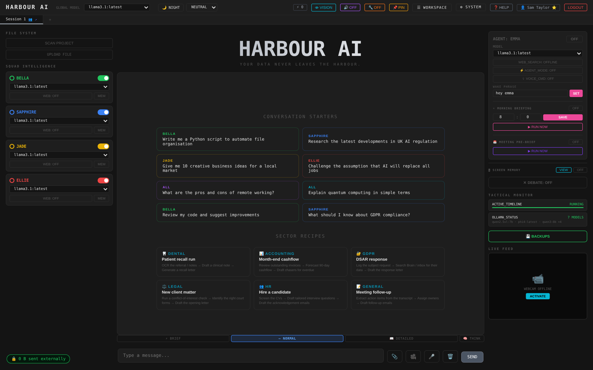

<!-- NOTE: the direct-download links below are deliberately VERSION-LESS. CI publishes
     byte-identical version-less aliases (HARBOUR-AI-Setup.exe, HARBOUR-AI.AppImage, …) on
     every release, so releases/latest/download/<name> always resolves. Do NOT re-pin them
     to a version — that's what 404'd every download link at v1.0.137 and again at v1.2.0.
     Only the version badge below needs bumping. -->

# HARBOUR AI

## Private AI for people who can't send their data to the cloud.

A complete AI workforce — five specialist agents and 150+ business tools — that runs **entirely on your own computer**. No cloud. No subscription. No data leaving your machine. And now, provably so: every answer carries a cryptographic receipt you can verify yourself.

---

## ⬇ Download — free 14-day trial, no card

| Windows | Linux | macOS |
|:---:|:---:|:---:|
| [**Download installer (.exe)**](https://github.com/LOOSEKEY/harbour-ai-releases/releases/latest/download/HARBOUR-AI-Setup.exe) | [**Download AppImage**](https://github.com/LOOSEKEY/harbour-ai-releases/releases/latest/download/HARBOUR-AI.AppImage) | [**Download .dmg**](https://github.com/LOOSEKEY/harbour-ai-releases/releases/latest/download/HARBOUR-AI.dmg) |
| [Portable .exe](https://github.com/LOOSEKEY/harbour-ai-releases/releases/latest/download/HARBOUR-AI-Portable.exe) | [.deb package](https://github.com/LOOSEKEY/harbour-ai-releases/releases/latest/download/HARBOUR-AI.deb) | Apple Silicon (M1+), macOS 14+ |

> ✅ **v1.3.35 ships on Windows and Linux; the Mac download is v1.3.34** until the 1.3.35 Mac build is ready. The Mac app is not yet signed with an Apple Developer certificate, so the first time you open it macOS stops it: click **Done**, then **System Settings → Privacy & Security → Open Anyway**. After that it opens normally. When a new version is out, the Mac app tells you and opens the download.

You'll also need [**Ollama**](https://ollama.com) — the free local AI engine. Two minutes, one command ([3-step setup below](#-get-running-in-3-steps)). *[Browse all releases →](https://github.com/LOOSEKEY/harbour-ai-releases/releases/latest)*

> 🛡️ **Now shipping — v1.3.35: a security update, please install it.** A document-indexing route accepted any file in HARBOUR's own data folder, which is also where the key that signs everyone's sign-ins is kept: a signed-in account that called it directly could read that key and act as an administrator. It now accepts only the account's own uploaded documents. Each account's documents under RAG / Documents are also now kept in a folder of their own, so two people uploading a file with the same name no longer replace each other's copy, and removing a document deletes the stored file. If you are the only user, nothing changes. Windows and Linux update themselves: restart HARBOUR.

---

## Why HARBOUR, not ChatGPT?

🔒 **Your data never leaves.** Everything runs on your machine — chats, documents, everything. Nothing is sent anywhere, ever. For solicitors, accountants, clinicians, and anyone bound by GDPR or client confidentiality, that isn't a feature — it's the whole point.

✅ **And you can prove it.** Every AI answer is cryptographically signed. Verify any output — or your entire audit trail — at [harbour-ai.co.uk/verify](https://harbour-ai.co.uk/verify), with no HARBOUR install needed. No cloud AI can offer this, because their business *is* your data leaving.

👥 **A workforce, not a chatbot.** Five specialists — EMMA, BELLA, SAPPHIRE, JADE, ELLIE — debate and synthesise every answer, across 150+ ready-made tools built for UK business.

💷 **Pay once.** £149, yours forever. No subscription, no usage fees, no telemetry.

---

## What's inside

**Five agents working together on every query:**

| Agent | Role |
|---|---|
| 💖 **EMMA** | Orchestrator — synthesises a final verdict across the squad |
| 💚 **BELLA** | Code & technical |
| 💙 **SAPPHIRE** | Research & analysis |
| 💛 **JADE** | Creative & lateral thinking |
| ❤️ **ELLIE** | Critic & devil's advocate |

**150+ tools**, including:

- 🛡 **Trust Layer** — signed AI receipts, tamper-evident audit ledger, encrypted vault, e-signature, injection firewall
- 🧠 **Self-improving intelligence** — smart model routing, semantic answer cache, self-critique, and a built-in eval harness so answers get better and faster
- ⚖️ **Legal** — contract drafting & review, NDA builder, conveyancing, employment law, SRA conflict checks
- 💷 **Finance** — payroll with HMRC RTI calculations, bank transaction analysis, MTD VAT/ITSA, invoicing, cash-flow forecasting
- 🏥 **Healthcare** — NHS FHIR R4 records (local), CQC self-assessment, clinical decision support, GP referrals
- 📋 **Compliance** — full GDPR suite (DPIA, RoPA, DSAR, breach response), ISO 27001, Cyber Essentials evidence, whistleblowing portal
- 👥 **HR & Sales** — HRIS, recruitment & AI video interviews, CRM, proposals, client sentiment monitoring
- 🧭 **Sector packs** — conveyancing, insurance, recruitment, property & lettings, **dental, veterinary, pharmacy, opticians, construction (CDM), hospitality, logistics, manufacturing, funeral services**
- 🛠 **Everyday tools** — slide generator, spreadsheet AI, handwriting OCR, whiteboard→notes, data lineage, auto-classification, vendor risk, board-pack/KPI commentary
- 🎙 **Productivity** — live meeting transcription, document intelligence, workflow automation, Company Brain knowledge graph

[See everything at harbour-ai.co.uk →](https://harbour-ai.co.uk)

---

## 🚀 Get running in 3 steps

1. **Install [Ollama](https://ollama.com)** — the free local AI engine
2. **Download HARBOUR** for your platform (above) and launch it
3. **It pulls a model on first run** (`llama3.1`) — then you're working, fully offline from there on

> **Requirements:** Windows 10/11, Linux (Ubuntu 20.04+ / Debian 11+), or macOS 14+ on an Apple Silicon Mac (M1 or later) · 8 GB RAM (16 GB recommended) · ~6 GB disk for the app + model. No internet needed after setup.

---

## Pricing

| Tier | Price | Users |
|---|---|---|
| **Solo** | £149 one-time | 1 |
| **Business** | £999 one-time | 25 — shared Company Brain, admin dashboard, audit trail |
| **Reseller** | £2,499 one-time | 50 white-label seats |
| **Enterprise** | from £9,999 | Unlimited — SSO (Active Directory / SAML), custom deployment, SLA, onboarding |

One-time purchase, yours forever. Optional **HARBOUR CARE** annual support: Solo £59/yr · Business £199/yr. [Full pricing →](https://harbour-ai.co.uk/#pricing)

Reselling? White-label packs: 10 deployments £999 · 25 £1,999 · 50 £2,499. **Building HARBOUR into your own branded hardware?** Appliance partners get a bespoke agreement — [get in touch](mailto:Gregorymoores@proton.me).

---

## For organisations — HARBOUR AI Box

Don't want to install anything? The **HARBOUR AI Box** is a turnkey appliance — a mini-PC we (or a partner) pre-configure with HARBOUR AI, Ollama, and your chosen models, and ship ready to plug in. Ideal for NHS trusts, councils, and regulated organisations: connect power and ethernet, your team logs in over the local network, and nothing ever leaves the room. [Learn more →](https://harbour-ai.co.uk/appliance.html)

---

## Built, stable, and maintained for the long term

HARBOUR AI is a **finished, mature product** — 150+ specialist modules, a full cryptographic trust layer, and the complete five-agent workforce, all shipped and battle-tested. It isn't a perpetual beta or a startup that might vanish next quarter.

From here, development is deliberately steady: **security updates, dependency patches, and stability fixes — kept current for years.** Your one-time licence already includes every current feature *and* all future updates, so the app on your machine only gets safer and more reliable over time. Bigger directions (hardware-backed key vaults, privacy-preserving federated learning at scale, more sector packs) stay on the table for if and when there's clear demand — but the core you're buying today is complete.

---

## Who's behind HARBOUR

HARBOUR AI is built by **Gregory Moore**, who grew up in Birmingham, UK, and has lived in Rugby for the past ten years. He has been coding since the nineties, right up to today, alongside plenty of jobs away from computers, and all the way through he has built apps and websites the old way for the people who ask for them. He has also built underground server rooms for private clients and businesses. His daughter, **Nevaeh Moore**, works with him side by side and answers calls and email when he's away.

First released in April 2026 and launched publicly on 12 May 2026. Two companies use it, one in the UK and one in Germany, alongside a growing number of people running it on their own. Once a bought licence key is activated, HARBOUR never needs to check in with us again, so your copy keeps working whatever happens. Contact: Gregorymoores@proton.me. **[Read the full story →](STORY.md)**

Also by Gregory Moore: [EMMA](https://ownemma.com) · [Build Emma](https://buildemma.com) · [CODE-STORE](https://code-store.co.uk)

---

## Links

[Our story](STORY.md) · [Website](https://harbour-ai.co.uk) · [Community Discord](https://harbour-ai.co.uk/discord) · [HARBOUR AI Box](https://harbour-ai.co.uk/appliance.html) · [User Manual](https://harbour-ai.co.uk/manual.html) · [Verify a receipt](https://harbour-ai.co.uk/verify) · [GDPR & governance](https://harbour-ai.co.uk/gdpr.html) · [Enterprise](https://harbour-ai.co.uk/enterprise.html) · Support: Gregorymoores@proton.me

---

*HARBOUR AI — your data never leaves the harbour.*
